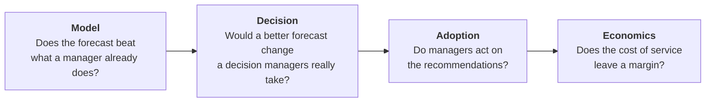
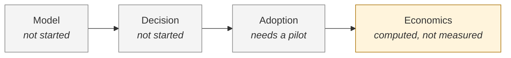

# Proof protocol: what would prove Aetherix wrong

> **Pre-registered.** Frozen on 2026-07-29 in the private Aetherix repository, amended once on 2026-08-01, published here on the date of this file's first commit. That commit date is the timestamp a reader can verify. The two earlier dates are the author's record and cannot be checked from outside.

Most product claims are judged after the results are in, by whoever produced them. This document fixes, before any result is read, what Aetherix has to show, against what, and what happens if it does not. A result below a threshold is a failure of that link, not an invitation to move the threshold.

## Contents

1. [The chain of proof](#the-chain-of-proof)
2. [Which number decides](#which-number-decides)
3. [The baseline](#the-baseline)
4. [The decision horizon](#the-decision-horizon)
5. [Thresholds and stopping rules](#thresholds-and-stopping-rules)
6. [Anti-bias rules](#anti-bias-rules)
7. [Where each link stands](#where-each-link-stands)
8. [Not covered: the earlier benchmark](#not-covered-the-earlier-benchmark)
9. [Amendment log](#amendment-log)
10. [How to check it](#how-to-check-it)

---

## The chain of proof

Aetherix is worth building only if four things are true at once. Each is a link, each has its own test, and a failed link is not rescued by the others.



| Link | Question | Test | Decides |
| --- | --- | --- | --- |
| Model | Does the forecast add anything an experienced manager does not already have? | Shadow mode on a real restaurant's history | Keep or replace the forecasting engine |
| Decision | Would a reliable forecast change a decision managers actually take? | Five interviews with F&B managers | Keep or change the product's wedge |
| Adoption | Do managers act on what they receive? | Acceptance rate in a real pilot | Keep or change the surface |
| Economics | Does the business model hold? | Full cost per property per month | Pricing and viability |

---

## Which number decides

**The forecast error (MAPE) is not the product decision metric.** A low absolute error on an easy dataset proves nothing. What counts is the **gap** between Aetherix and a simple rule that a manager already applies, at the horizon where a decision is still possible.

| Rank | Metric | Role |
| --- | --- | --- |
| Product decision | Gap to the naive baseline at the decision horizon | Is the forecast worth having? |
| Product decision | Recommendation acceptance rate | Does the manager act? |
| Product decision | Gross margin per property | Does the model hold? |
| Internal quality | Absolute MAPE and MdAPE | Non-regression only. Decides nothing on its own |

Consequence: no external communication leads with an absolute forecast error.

<details>
<summary>The terms, in plain words</summary>

| Term | Meaning |
| --- | --- |
| MAPE | Mean absolute percentage error per day. One day with 2 real covers forecast at 10 counts as a 400% error and can dominate the average. |
| MdAPE | The same error, taken as a median: the typical day. Less distorted by near-empty days. The primary metric here. |
| WAPE | Total absolute error divided by total real covers. The only one of the three expressed in covers, so the only one that converts into staff hours and euros. Reported, not decisive. |
| Gap (Δ) | Baseline MdAPE minus Aetherix MdAPE. Positive means Aetherix is better. |
| Point (pp) | A percentage point. Going from 27.6% to 22.6% is a gap of 5 points. |

</details>

---

## The baseline

**Reference baseline: the mean of the last four same weekdays.** It formalises what an experienced manager does without a tool ("the last four Tuesdays"). Beating a weaker rule (a 7-day rolling mean, yesterday's value) would prove nothing interesting.

**Mandatory second comparator: a gradient-boosted model** (LightGBM, global, lags of 7 to 28 days plus calendar features). It won on the median in the earlier benchmark. Leaving it out of a later comparison would turn a comparison into a sales argument.

**Primary comparison metric: MdAPE.** MAPE is reported as a secondary reading of robustness to extreme days, never alone. WAPE is reported as well (amendment of 2026-08-01).

---

## The decision horizon

The useful horizon is **measured, not assumed.** Forecasts are commonly scored one day ahead, but F&B schedules are often fixed a week or two in advance. If no real decision can still change one day ahead, an excellent one-day-ahead score is progress nobody can use.

1. The interviews set the decision horizon **H**: how far ahead a manager can still change something (extra staff, cuts, orders).
2. H is written into the amendment log, with its date, **before** the model results are read at H.
3. The thresholds apply at H, not at whichever horizon gives the best number.

Whatever H turns out to be, the model report publishes the **full grid** of horizons, one to seven days ahead.

---

## Thresholds and stopping rules

### Model link: shadow mode on real data

Decision metric: **gap in MdAPE (naive baseline minus Aetherix) at horizon H**, on real data.

| Gap | Verdict | What follows |
| --- | --- | --- |
| 5.0 points or more | **PASS** | The forecasting engine holds as a differentiator. Publishable. |
| From 2.0 to under 5.0 points | **GREY ZONE** | A written, dated decision is required before any communication. No implicit pass. |
| Under 2.0 points | **FAIL** | The forecast is not the product. A pivot note is mandatory. |

```
 gap in MdAPE, points      0          2                    5
 (baseline − Aetherix)     |----------|--------------------|------------------>
                               FAIL         GREY ZONE             PASS
```

The sample must be valid **before** the gap is read. Otherwise the result is neither PASS nor FAIL: it is reported as **inconclusive**, not turned into an encouraging trend.

- At least 12 months of continuous history, daily aggregates, no personal data.
- The same scoring protocol as the earlier benchmark: rolling origins five days apart (so every weekday is covered), a 7-day horizon, at least 300 scored points.
- A deterministic run that anyone with the data can reproduce.

### Decision link: five interviews

Decision metric: **how many of 5 managers say a reliable forecast at horizon H would change a decision they actually take.**

| Result | Verdict | What follows |
| --- | --- | --- |
| 3 or more of 5 | **PASS** | The link holds. H becomes the product's target horizon. |
| 2 of 5 | **GREY ZONE** | Three more interviews before any conclusion. |
| 1 or 0 of 5 | **FAIL** | The forecast meets no decision. The wedge itself is questioned. |

All five interviews are conducted and transcribed **before** any are aggregated. Stopping once three favourable answers are in would be optional stopping, and is not allowed.

### Adoption link

Recommendation acceptance rate of **at least 30%** (accepted or modified, over delivered). Measurable only in a real pilot with outcome capture. It is fixed here so the threshold is not chosen after seeing the first usage figures.

Secondary metric: weekly operational usage.

Context, not part of the frozen thresholds: acceptance alone can be gamed, because a system optimised on it learns to send bland recommendations that cost nothing to approve. [VISION.md](VISION.md) therefore pairs it with the manager's minutes per accepted recommendation.

### Economic link

| Metric | Pre-committed threshold |
| --- | --- |
| Gross margin per property, at 10 properties | 70% or more |
| Full cost per property per month | 15% or less of the intended price |

These are the only two thresholds that do not derive from an earlier measurement or decision. They are a reasonable commitment for an early-stage B2B product, revisable only through the amendment log and before the calculation is read. Volume scenarios of 1, 10 and 50 properties are all published, including the single-property case, which is structurally unfavourable.

### Pivot rule

A FAIL on the model link **or** the decision link triggers a written pivot note within five working days.

- **Model FAIL:** the forecast stops being presented as the differentiator. Documented options: switch the engine to the gradient-boosted model, or fall back openly on operational memory and the daily recommendation ritual as the product.
- **Decision FAIL:** the wedge itself is questioned, not only the engine. No application or external communication relies on the decision value of the forecast until the note exists.

A FAIL is a deliverable. It is published.

---

## Anti-bias rules

1. **Freeze.** Baseline, primary metric, thresholds and stopping rules are fixed at the freeze date. A later amendment counts only if it is logged and dated before the affected results are read.
2. **No post-hoc substitution.** Reporting MAPE because it flatters, without the MdAPE gap next to it, breaks the protocol.
3. **Exhaustive reporting.** Every pre-registered metric is published, including the ones that fail and the horizons not retained.
4. **One analysis pass.** One scoring run counts. Any rerun (a bug fix, a configuration change) is logged with its reason. An unlogged rerun that improves the result cannot be told apart from tuning on the test set.
5. **No optional stopping.** The sample size (five interviews, N scored points) is fixed in advance. Collection does not stop because the current result looks good.
6. **Declared deviations.** Any departure from the protocol is written in the result report, next to the result, not in a footnote.

---

## Where each link stands

As of 2026-10-08.



| Link | Status | Detail |
| --- | --- | --- |
| Model | Not started | Needs a 12-month daily export from a real restaurant. |
| Decision | Not started | Five interviews to run. They also set H, which the model link waits for. |
| Adoption | Not measurable yet | No hotel is connected. |
| Economics | Computed on 2026-07-30, one day after the freeze. **Estimated, not measured.** | Full cost of about $5.42 per property per month at 10 properties, from public price lists and modelled usage. Gross margin of 94.9% at the lowest market price anchor (€99 per property per month). Both thresholds pass. |

How to read the economic result: it passes by a wide margin, which means this threshold was too loose to be informative. It shows that the cost of service does not constrain the business. It says nothing about acquisition cost or churn, which are the real economic risks and sit outside this protocol. Every figure in it is to be measured again once real traffic exists.

---

## Not covered: the earlier benchmark

A forecast benchmark on public data was published on 2026-07-08, three weeks before this protocol existed. It was **not** pre-registered, and this document does not pretend otherwise.

- Data: 30 Japanese restaurants from the Kaggle Recruit dataset, 1,193 scored points. Restaurants, not hotels, with no occupancy signal.
- Mean MAPE: Prophet 49.71%, naive baseline 55.86%.
- MdAPE: Prophet 27.0%, naive baseline 27.6%. One day ahead: 28.5% against 27.9%, so Prophet is behind.
- A gradient-boosted model reached 25.6% on the median.

For scale only: the median gap in that benchmark is 0.6 points, which the model thresholds above would place in the fail band. That benchmark used public restaurant data and no decision horizon, so it is not judged by this protocol. The figure is given so nobody has to compute it.

---

## Amendment log

Any change to the baseline, the horizon or the thresholds is entered here with its date and reason. An amendment made after reading the results it affects is void and must be flagged as such.

| Date | Change | Reason | Before the affected results were read? |
| --- | --- | --- | --- |
| 2026-07-29 | Initial freeze | Pre-registration | Yes. No covered test had started. |
| 2026-08-01 | WAPE added as a mandatory reported metric. Primary metric and model thresholds unchanged. | WAPE is the only metric in covers, so the only one that converts to staff hours and euros. A reported metric added, not a primary one replaced. | Yes. The model test had not started. |
| This commit | Published in this repository | Make the timestamp verifiable by anyone | Yes. Model and decision tests not started. |
| Pending | **H, the decision horizon** | Set by the interviews | Must be entered before model results are read at H |

---

## How to check it

```bash
# When was this protocol first published here?
git log --follow --format='%aI %h %s' -- PROOF_PROTOCOL.md | tail -1

# Results covered by it must be committed after that date.
git log --format='%aI %h %s' -- benchmark/
```

If a result covered by this protocol was committed before the protocol, the guarantee does not apply to it, and its report must say so. Results will be published as they arrive, failures included.

---

Related: [EVAL_GATE.md](EVAL_GATE.md) for the pre-merge evaluation gate, [VISION.md](VISION.md) for why the loop matters more than the forecast, and the Field Note [Evaluating LLM agents: how would you know it had stopped working?](https://ivandemurard.com/journal/harnesses-graders-closed-loops).
